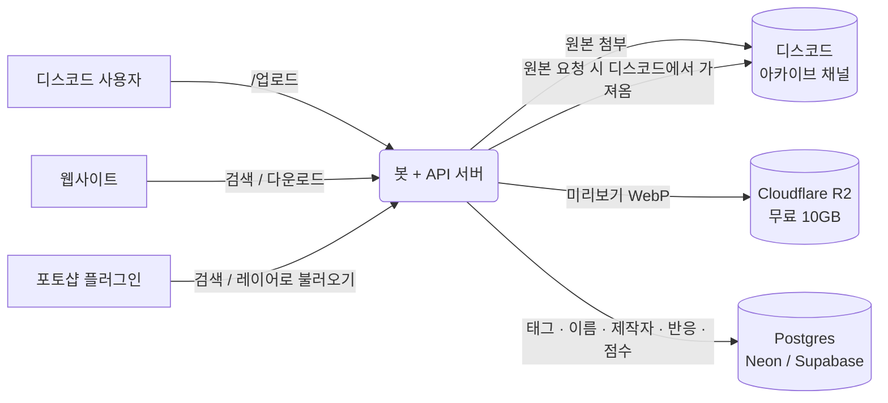

# GFX References

GFX References 디스코드 서버의 썸네일 · 작업물 **레퍼런스 아카이브** 시스템입니다.

| 구성 | 하는 일 |
| --- | --- |
| 🤖 **디스코드 봇** | `/업로드` 로 레퍼런스 등록, `/검색` · `/랜덤` · `/인기` · `/색상` 으로 찾기, 반응(⭐🔥👍), 기여 점수 `/랭킹` |
| 🗄️ **인터넷 데이터베이스** | 미리보기용 **압축 이미지(WebP)**, 태그 · 사진 이름 · 맵 이름 · 제작자 정보, 반응, 점수 |
| 🌐 **웹사이트** | 검색 · 필터 · 인기 · 색상별 모아보기 · 랭킹 · 프로필, 썸네일을 유튜브 화면처럼 보는 Feed, 디스코드 로그인 후 **원본 다운로드**, 한국어 / English 전환 |
| 🎨 **포토샵 플러그인** | 패널에서 검색하고 **원본을 새 레이어로 불러오기**, 팔레트 색을 전경색으로 |

원본 사진은 **디스코드 서버의 아카이브 채널**에 그대로 보관되고, 사이트나 플러그인에서 다운로드를 누르면
봇이 디스코드에서 원본을 가져와 전달합니다. 데이터베이스에는 가벼운 미리보기와 정보만 저장하므로
무료 저장소(Cloudflare R2 무료 10GB)로도 수만 장을 담을 수 있습니다.



## 레퍼런스 분류

| 분류 | 정보 |
| --- | --- |
| 🖼️ **지메 썸네일** | 맵 이름(필수), 제작자, 태그 |
| 🎨 **지메 기타 작업물** | 제작자, 태그 |
| ✨ **비지메** | 제작자, 태그 |

기본 태그: `glow` `grunge` `3d` `blender/c4d` `modern` `central-texted-composition`
`non-central-texted-composition` `multi-colored` `poster-like` `paint` `complex`
— 관리자는 `/관리 태그추가` 로 늘릴 수 있습니다.

## 주요 기능

- **업로드** — 이미지 · 분류 · 맵 이름 · 제작자(이름 또는 멘션) · 태그(자동완성). 올리면 미리보기 압축, 색상 분석,
  **비슷한 이미지 중복 경고**(지각 해시)까지 자동으로 합니다.
- **검색** — 제목 / 맵 이름 / 제작자 / 태그 / `#번호`, 분류 · 태그(여러 개 AND) · 색상 · 제작자 필터, 최신 · 인기 · 무작위 정렬.
- **랜덤 레퍼런스** — `/랜덤` (분류 · 태그 · 색 조건 가능), 🎲 버튼으로 다시 뽑기.
- **반응 & 인기** — 카드의 ⭐🔥👍 버튼, 사이트 버튼, **아카이브 메시지의 디스코드 반응**이 모두 같은 집계로 합쳐집니다.
  `/인기` 는 이번 주 · 이번 달 · 올해 · 전체 기간별, 매주 월요일 **이번 주 TOP 5** 자동 게시.
- **색상별 모아보기** — 업로드할 때 대표 팔레트와 색 분포를 분석해서
  - 빨강 · 파랑 같은 **색 계열**로 모아보기 (`/색상 계열`)
  - 원하는 **색 코드**(#ff0044)가 들어간 레퍼런스 찾기 (`/색상 코드`)
  - 특정 레퍼런스와 **색감이 비슷한** 레퍼런스 찾기 (`/색상 비슷한`, 사이트의 “비슷한 색감”)
- **기여 점수** — 업로드 +10점, 내 레퍼런스가 받은 반응 ⭐ +2 · 🔥 +1.5 · 👍 +1점(자기 반응 제외, `REACTION_POINTS` 로 조정), 관리자 보너스. `/랭킹`, `/프로필`, 사이트 랭킹.
  점수는 매번 계산하므로 레퍼런스를 지우면 점수도 자동으로 빠집니다.
- **원본 다운로드** — 사이트/플러그인은 디스코드 로그인(OAuth 또는 `/연동` 코드)이 필요하고,
  “디스코드 DM으로 받기”도 지원합니다.

## 디스코드 명령어

한국어 디스코드에서는 한국어 이름으로 보입니다 (영어 클라이언트에서는 괄호 안 이름).

| 명령어 | 설명 |
| --- | --- |
| `/업로드` (`/upload`) | 레퍼런스 올리기 — 이미지 · 분류 · 맵이름 · 제작자 · 제작자멘션 · 태그 · 제목 |
| `/검색` (`/search`) | 검색어 · 분류 · 태그 · 색상 · 제작자 · 정렬 · 공개 |
| `/랜덤` (`/random`) | 랜덤 레퍼런스 (🎲 다시 뽑기) |
| `/인기` (`/popular`) | 기간별 인기 레퍼런스 |
| `/색상 계열` · `/색상 코드` · `/색상 비슷한` | 색으로 찾기 |
| `/보기` (`/view`) | 번호로 보기 (자동완성) |
| `/수정` · `/삭제` | 내가 올린 레퍼런스 수정/삭제 (관리자는 전부) |
| `/랭킹` (`/leaderboard`) · `/프로필` (`/profile`) | 점수 |
| `/태그목록` (`/tags`) | 태그 목록과 개수 |
| `/연동` (`/link`) | 포토샵 플러그인 · 사이트 로그인 코드 승인 |
| `/관리` (`/admin`) | 태그추가 · 태그삭제 · 태그이름변경 · 태그설명 · 점수조정 · 하이라이트 · 통계 (관리자 전용) |
| `/도움말` (`/help`) | 사용법 |

검색 결과 카드에는 ◀ ▶ 페이지 넘기기, 반응 버튼, **📥 원본 받기**, **🎨 비슷한 색감**, 사이트 링크가 있습니다.

## 폴더 구조

```
server/            봇 + REST API + 정적 사이트 제공 (Node.js · TypeScript)
  src/bot/         디스코드 봇 (명령어, 버튼, 반응 동기화, 주간 하이라이트, 아카이브)
  src/api/         REST API (Hono) — 웹사이트 · 플러그인이 사용
  src/services/    업로드 처리, 색상 분석, 중복 검사, 검색, 점수
  src/repos/       SQL 쿼리 (Postgres / PGlite)
  src/storage/     미리보기 저장소 (로컬 / S3 · R2)
  test/            테스트 (vitest)
web/               웹사이트 (빌드 없는 정적 SPA, 화면 문구는 web/assets/js/i18n.js)
photoshop-plugin/  포토샵 UXP 패널 플러그인
docs/              설치 · 배포 가이드
```

## 빠르게 실행해 보기 (디스코드 없이)

```bash
cd server
npm install
BOT_ENABLED=false npm run seed:demo   # 데모 레퍼런스 36개 생성
BOT_ENABLED=false npm run dev         # http://localhost:3000
```

데이터는 `server/data/` 에 저장됩니다 (내장 Postgres · 로컬 미리보기 · 로컬 원본).

## 실제 운영

디스코드 봇 만들기, Neon(무료 Postgres) · Cloudflare R2(무료 10GB) 연결, 서버 배포, 포토샵 플러그인 설치는
**[docs/SETUP.md](docs/SETUP.md)** 에 순서대로 정리했습니다.

```bash
cd server
cp .env.example .env   # 값 채우기
npm install
npm run build
npm start
```

또는 Docker:

```bash
docker compose up -d --build
```

## 개발

```bash
cd server
npm test          # 단위 · API · 봇 흐름 테스트
npm run typecheck
```

- 봇 흐름 테스트(`test/bot-flow.test.ts`)는 디스코드에 접속하지 않고 가짜 인터랙션으로 업로드 → 중복 확인 → 검색 → 반응 → 원본 받기 → 삭제까지 시험합니다.
- 슬래시 명령어는 봇이 켜질 때 정의가 바뀌었으면 자동으로 등록됩니다 (`npm run deploy-commands` 로 수동 등록도 가능).
- DB 스키마는 `server/src/db/migrations.ts` 에 있고, 시작할 때 자동으로 적용됩니다.
